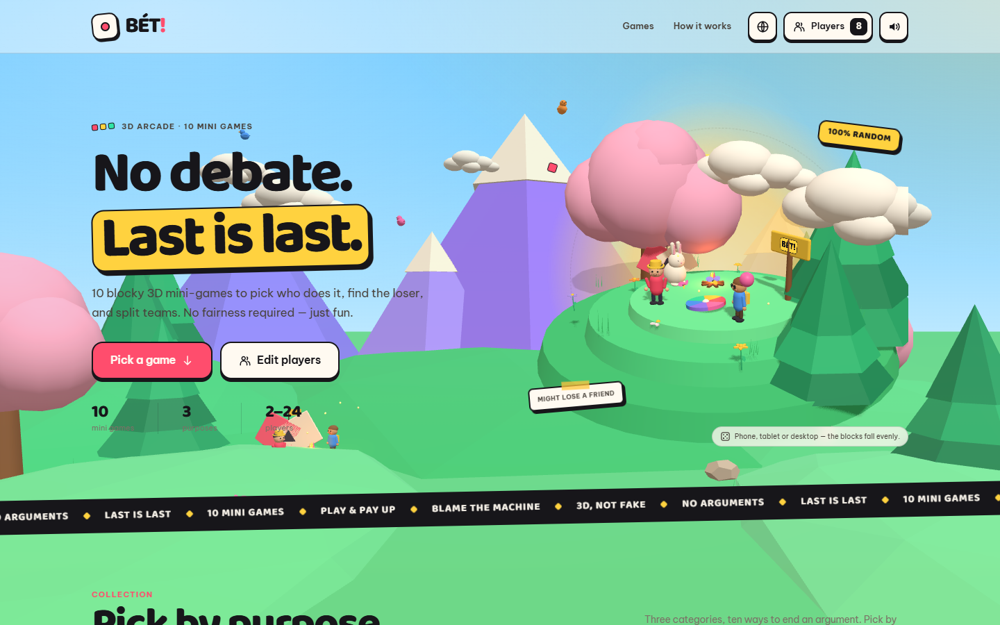
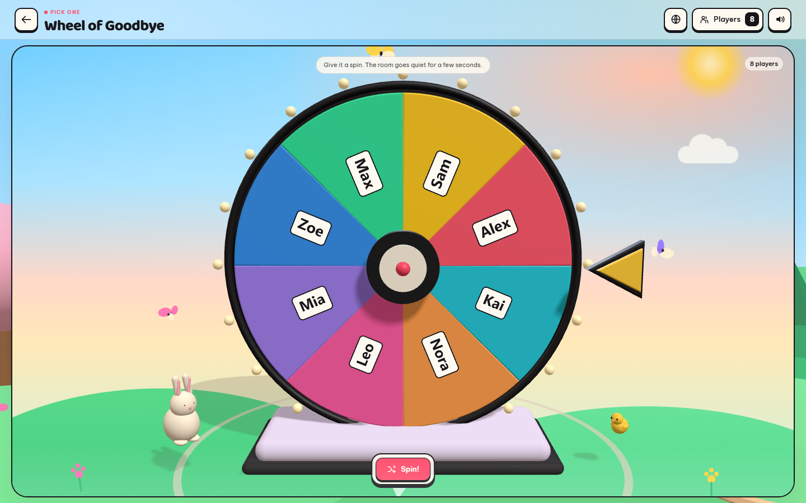
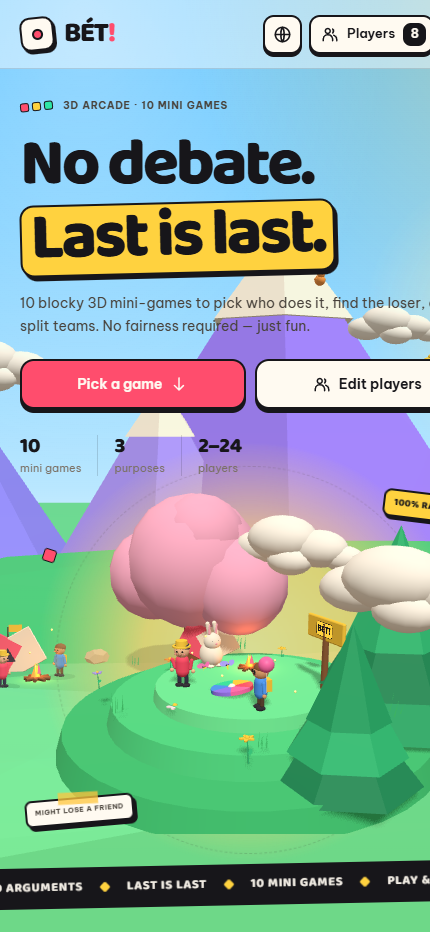

<div align="center">

# 🎲 BÉT! — 3D Party Arcade

**A tiny 3D world of party games.** Pick a person, find the last-place loser, or split the team — no arguments, last is last.

[](https://sondv5.github.io/bet-arcade/)
[](https://github.com/sondv5/bet-arcade/actions/workflows/deploy.yml)
[](LICENSE)
[](https://github.com/sondv5/bet-arcade/graphs/contributors)
[](https://github.com/sondv5/bet-arcade/issues)

[](https://react.dev)
[](https://threejs.org)
[](https://vite.dev)
[](https://web.dev/learn/pwa)
[](src/i18n)

</div>

---

## 📸 Preview

<div align="center">
  
</div>

<details>
<summary>More screenshots</summary>

| Wheel of Goodbye | Mobile |
| :---: | :---: |
|  |  |

</details>

---

## 🎯 What is it?

**BÉT!** is a browser-based party arcade built with **Three.js**. You add the names of the people in the room, pick a mini-game, and let the machine decide — the wheel spins, the ball drops, the bomb ticks, the cards flip. It removes the "no, you go" deadlock from any group.

**Everything runs on the client.** No accounts, no server, no data leaves the device. Player rosters and settings live in `localStorage`.

### ✨ Highlights

- **10 mini-games** across 3 categories — pick one, find the last place, split teams & pairs.
- **Fully 3D scenes** — animated characters, mascots, scenery and particle effects built procedurally with Three.js (no external 3D assets).
- **Installable PWA** — offline-ready, works on phones, tablets and desktops.
- **8 languages** — English, Tiếng Việt, 中文, 日本語, 한국어, Español, Français, Português. Auto-detected from the browser, with a manual switcher.
- **Procedural sound effects** — synthesized with the Web Audio API, no audio files.
- **Bring your own players** — 2 to 24 people, with color-coded avatars.
- **Responsive** — designed mobile-first, verified on phone, tablet and desktop viewports.

---

## 🎮 The games

| # | Game | Category | Players | What it does |
| :--: | :--- | :--- | :--- | :--- |
| 1 | **Wheel of Goodbye** | Pick one | 2–24 | Spins a 3D wheel and picks a name. Unfair, but demonstrably fair. |
| 2 | **Plinko of Fate** | Pick one | 2–12 | Drops a golden ball through pegs into one of the slots. |
| 3 | **Lucky Slots** | Pick one | 2–12 | Three reels, one jackpot, one heartbreak. |
| 4 | **Hot Bomb** | Last place | 2–24 | A bomb with a burning fuse — hold too long and it goes off. |
| 5 | **Snail Race** | Last place | 2–24 | Slowest racer across the meadow. Being slow is a talent too. |
| 6 | **Skull Card** | Last place | 2–12 | One card holds the skull. Flip at your own risk. |
| 7 | **Hammer of Fate** | Last place | 2–24 | Aim, swing, and let fate pick the target. |
| 8 | **Team Machine** | Teams | 2–24 | Splits the room into perfectly balanced teams. |
| 9 | **Gacha Teams** | Teams | 2–24 | Capsules drop, destiny comes in plastic. |
| 10 | **Pair Machine** | Teams | 2–24 | Pairs you up — or forces a face-off for the odd one out. |

---

## 🛠 Tech stack

| Layer | Choice |
| :--- | :--- |
| UI | React 19 (hooks, no state library) |
| 3D | Three.js r186 — all geometry, materials and characters generated in code |
| Build | Vite 8 |
| Routing | Hash-based router (`#/game/:id`) — works on any static host |
| Styling | Plain CSS with custom properties, mobile-first |
| i18n | Lightweight custom provider with per-key English fallback |
| Audio | Web Audio API (procedural synthesis) |
| PWA | Web App Manifest + custom service worker (precache + runtime cache) |
| Icons | Generated with `sharp` (`npm run icons`) |

**Zero runtime dependencies beyond React and Three.js.**

---

## 🚀 Getting started

```bash
git clone https://github.com/sondv5/bet-arcade.git
cd bet-arcade
npm install
npm run dev
```

The dev server starts on <http://localhost:5173>.

### 📜 Available scripts

| Command | Description |
| :--- | :--- |
| `npm run dev` | Start the Vite dev server on the LAN (`--host 0.0.0.0`). |
| `npm run build` | Production build into `dist/`. |
| `npm run preview` | Serve the production build locally. |
| `npm run icons` | Regenerate PWA icons from `public/icons/icon.svg`. |
| `npm run deploy:pages` | Build and publish `dist/` to the `gh-pages` branch. |

---

## 🌐 Deployment

The project is a static bundle, so it can be hosted anywhere. It is currently live on **GitHub Pages**:

> **https://sondv5.github.io/bet-arcade/**

Two supported paths:

1. **GitHub Actions** — push to `main`; the `Deploy to GitHub Pages` workflow builds and publishes automatically.
2. **Manual `gh-pages` push** — `npm run deploy:pages` builds and force-pushes `dist/` to the `gh-pages` branch.

Because the router is hash-based and `base` is set to `'./'`, the app works correctly from a sub-path such as `/bet-arcade/` with no extra configuration.

---

## 🗂 Project structure

```text
bet-arcade/
├── public/                 # PWA manifest, service worker, generated icons
│   ├── icons/              # App + maskable icons (sharp-generated)
│   ├── manifest.webmanifest
│   └── sw.js               # Precache + runtime cache, offline support
├── scripts/
│   ├── deploy-pages.mjs    # Builds and publishes to the gh-pages branch
│   └── generate-icons.mjs  # Regenerates the PWA icon set
├── src/
│   ├── components/         # Dashboard, HeroScene, AmbientScene, shell, modals
│   ├── data/games.js       # Game registry (id, category, limits, component)
│   ├── games/              # One folder per mini-game (+ its CSS)
│   ├── hooks/              # PWA install/update hooks
│   ├── i18n/               # Provider + 8 locale files
│   ├── lib/                # threeKit, characters, scenery, sfx, players, random
│   ├── styles/             # base.css, home.css, game.css
│   ├── App.jsx             # Hash router + game registry wiring
│   └── main.jsx            # App bootstrap
├── docs/images/            # README screenshots
└── index.html
```

---

## 🌍 Adding a language

1. Copy `src/i18n/locales/en.js` to `src/i18n/locales/<code>.js`.
2. Translate the strings.
3. Register the locale in `src/i18n/index.jsx` (`LOCALES` + `LANGUAGES`).
4. Run `npm run dev` — the language appears in the switcher automatically.

Missing keys fall back to English, so a partial translation never breaks the UI.

---

## 🎨 Adding a mini-game

Follow the contract in [`src/games/GAME_CONTRACT.md`](src/games/GAME_CONTRACT.md). In short: a game folder exporting a React component, registered in `src/data/games.js` with an id, category, player limits and accent color.

---

## 🤝 Contributing

Contributions are welcome — bug reports, new mini-games, translations and polish.

- Read [CONTRIBUTING.md](CONTRIBUTING.md) before opening a pull request.
- Use the issue templates (bug report / feature request) so we can reproduce problems quickly.
- The project follows the [Code of Conduct](CODE_OF_CONDUCT.md).

## 🔐 Security

Please do not report vulnerabilities in a public issue. See [SECURITY.md](SECURITY.md).

## 📄 License

Released under the [MIT License](LICENSE). © 2026 sondv5

---

<div align="center">
  <sub>Built with Three.js, React and an unreasonable amount of pastel scenery. 🐰</sub>
</div>
